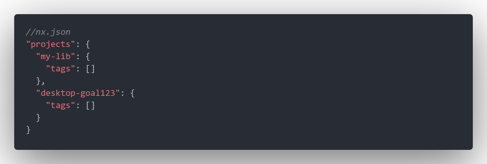
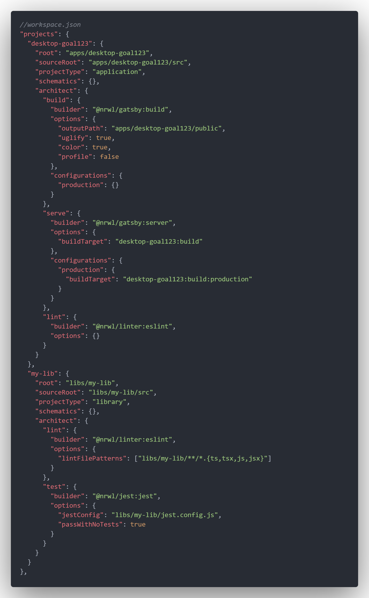
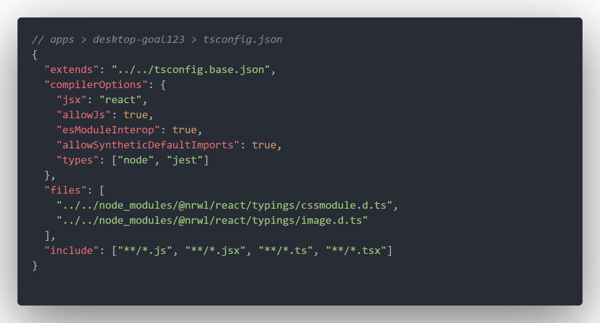
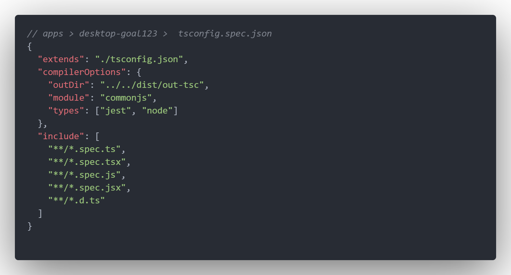

# AilabDesktop

This project was generated using [Nx](https://nx.dev).

## npm install

使用以下指令安裝第三方套件

```bash
npm install --legacy-peer-deps
```

---

## Development server

Run `nx serve {my-app}` for a dev server. The app will automatically reload if you change any of the source files.

**Nova88**
Run `nx serve nova88v2`
Will auto navigate to <http://localhost:42012>

**Goal123**
Run `nx serve goal123`
Will auto navigate to <http://localhost:4202>

**Bwing**
Run `nx serve bwing`
Will auto navigate to <http://localhost:4203>

**Bwing**
Run `nx serve ivorysport`
Will auto navigate to <http://localhost:4204>

---

## Git commit format

Please refer to the file ./.gitmessage.txt

---

## Install the Nx Plugin for Gatsby in your Nx workspace

-   `yarn add @nrwl/gatsby --dev`

    or

-   `npm install @nrwl/gatsby --save-dev`

---

## Generate a new Gatsby application

-   `nx generate @nrwl/gatsby:app my-app`

## or

## Generate an application

-   `nx g @nrwl/react:app my-app`

---

## To serve the application

-   `nx serve my-app`

To build and serve the production application, use the --prod flag.

To build the application:

-   `nx build myblog`

[Gatsby support, custom workspace layouts, and more in Nx 9.4!](https://blog.nrwl.io/gatsby-support-custom-workspace-layouts-and-more-in-nx-9-4-497ae105bf4)

## Create Libs

-   `npx nx g @nrwl/react:lib ui`

[Create Libs](https://nx.dev/latest/react/tutorial/08-create-libs)

> You can also use any of the plugins above to generate libraries as well.

Libraries are sharable across libraries and applications. They can be imported from `@ailab-desktop/mylib`.

---

## 手動增加專案

在 `apps` 加入現有的專案需要加入的設定

-   `nx.json` 以及 `workspace.json` 加入必須加入需要用到的專案以及共用元件





-   專案裡需要加入的設定





---

## Code scaffolding

Run `nx g @nrwl/react:component my-component --project=my-app` to generate a new component.

## Build

Run `nx build my-app` to build the project. The build artifacts will be stored in the `dist/` directory. Use the `--prod` flag for a production build.

## Running unit tests

Run `nx test my-app` to execute the unit tests via [Jest](https://jestjs.io).

Run `nx affected:test` to execute the unit tests affected by a change.

## Running end-to-end tests

Run `ng e2e my-app` to execute the end-to-end tests via [Cypress](https://www.cypress.io).

Run `nx affected:e2e` to execute the end-to-end tests affected by a change.

## Understand your workspace

Run `nx dep-graph` to see a diagram of the dependencies of your projects.

## Further help

Visit the [Nx Documentation](https://nx.dev) to learn more.

## ☁ Nx Cloud

### Computation Memoization in the Cloud

<p align="center"></p>

Nx Cloud pairs with Nx in order to enable you to build and test code more rapidly, by up to 10 times. Even teams that are new to Nx can connect to Nx Cloud and start saving time instantly.

Teams using Nx gain the advantage of building full-stack applications with their preferred framework alongside Nx’s advanced code generation and project dependency graph, plus a unified experience for both frontend and backend developers.

Visit [Nx Cloud](https://nx.app/) to learn more.
